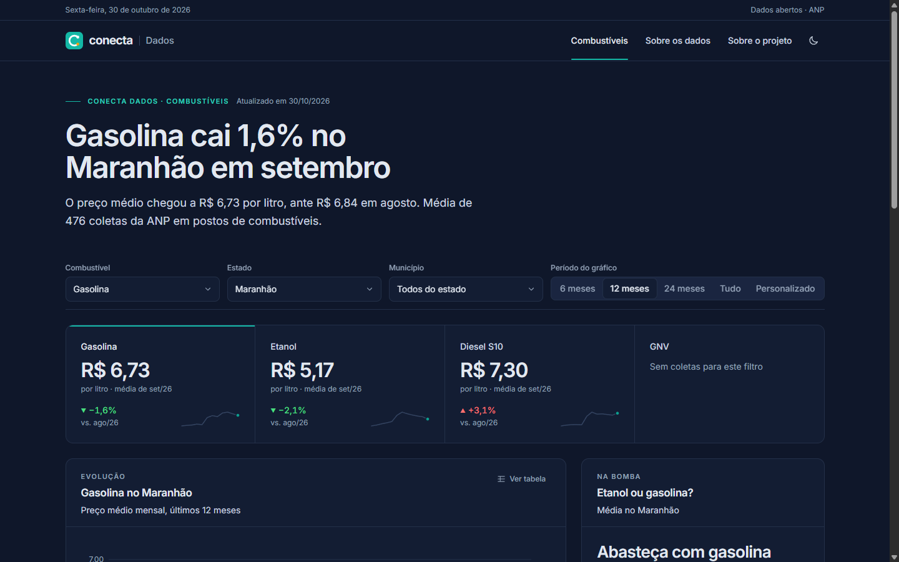
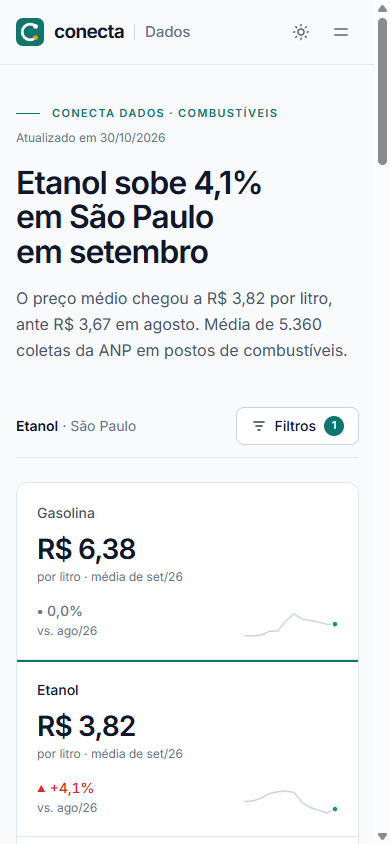
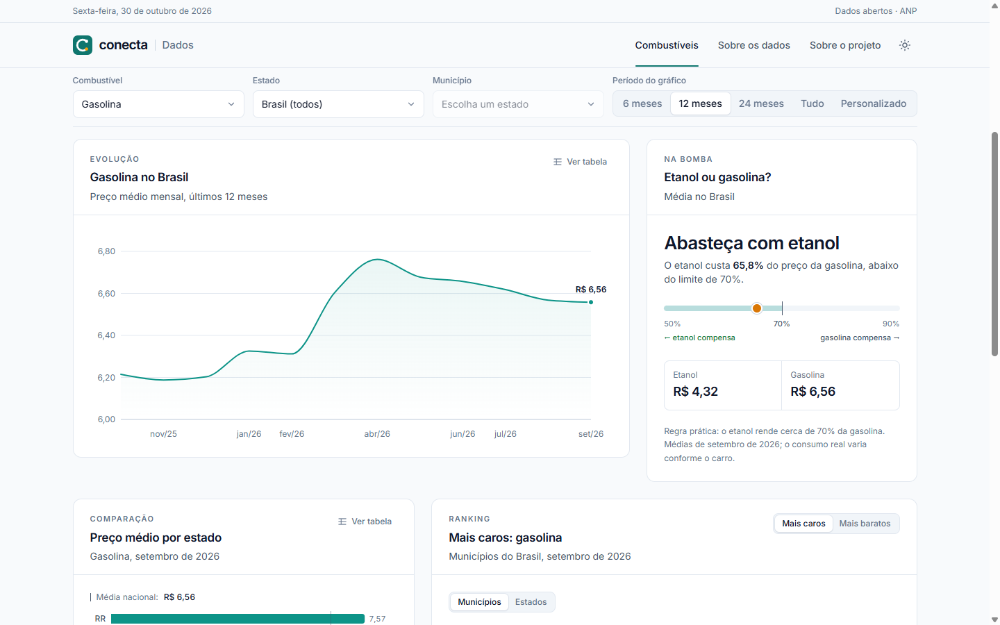

# Conecta

[](https://github.com/Romulo-Ferreira-Rego/Conecta/actions/workflows/testes.yml)
[](https://github.com/Romulo-Ferreira-Rego/Conecta/actions/workflows/atualizar-dados.yml)

Site onde são disponibilizadas informações sobre combustíveis e notícias relacionadas, de forma mais simples e intuitiva.

**🔗 Site no ar: [conecta-seven-tau.vercel.app](https://conecta-seven-tau.vercel.app)** · API: [documentação interativa](https://conecta-api-8bjr.onrender.com/docs)


## Sobre o projeto

O **Conecta** é um portal de informações e notícias. A primeira versão começa pela editoria de dados, com o **Conecta Dados: Combustíveis**: um painel público e gratuito que mostra a evolução e a comparação dos preços de combustíveis no Brasil.

### O problema

A ANP (Agência Nacional do Petróleo, Gás Natural e Biocombustíveis) publica a série histórica de preços de combustíveis como dados abertos, mas em arquivos grandes e pouco amigáveis, com centenas de milhares de linhas. O Conecta transforma esses dados em gráficos, rankings e filtros simples, para qualquer pessoa consultar.

**Público-alvo:** motoristas, motoristas de aplicativo, transportadores, estudantes e jornalistas.

### Funcionalidades

- **Manchete gerada dos dados**, em linguagem jornalística ("Gasolina cai 1,6% no Maranhão em setembro")
- **Cards** com o preço médio de gasolina, etanol, diesel S10 e GNV e a variação sobre o mês anterior
- **Gráfico de evolução** com período de 6, 12 ou 24 meses ou intervalo personalizado (mínimo de 3 meses)
- **Filtros** por combustível, estado, município e período, guardados na URL (qualquer consulta vira um link)
- **Preço por estado** e **rankings** dos municípios e estados mais caros e mais baratos
- **"Etanol ou gasolina?"**, com a regra dos 70%
- **Atualização automática** semanal dos dados da ANP
- Páginas **Sobre os dados**, **Política de Privacidade** (LGPD) e **Sobre o projeto**
- **Tema claro e escuro**, responsivo a partir de 360 px

| Tema escuro | Celular |
|---|---|
|  |  |



## Arquitetura

```
 ANP (dados abertos)        GitHub Actions (toda segunda, 6h)
        │                              │
        ▼                              ▼
   ETL Python ──────────────► PostgreSQL (Neon) ◄──── API FastAPI (Render) ◄──── Site React (Vercel)
 baixa, limpa e carrega       coletas + visão de        somente leitura,           gráficos, filtros
 sem duplicar (idempotente)   médias mensais            médias prontas             e rankings
```

| Camada | Tecnologia | Hospedagem |
|--------|-----------|-----------|
| ETL | Python 3.14 + pandas | GitHub Actions (semanal) |
| Banco de dados | PostgreSQL 18 + Alembic | Neon |
| API | FastAPI + SQLAlchemy | Render |
| Site | React 19 + Vite + TypeScript + Tailwind CSS + Recharts + Motion | Vercel |
| Testes | pytest · Vitest + Testing Library | GitHub Actions (a cada push) |

### Destaques técnicos

- **Importação idempotente:** `COPY` para tabela temporária + `INSERT ... ON CONFLICT DO NOTHING`; reimportar um arquivo nunca duplica registros.
- **Atualização inteligente:** o job lê a página da ANP, compara tamanho e hash com o que já foi importado e só baixa o que mudou.
- **Trava de qualidade:** se mais de 10% das linhas de um arquivo forem descartadas, a importação falha de propósito (provável mudança de formato da ANP).
- **Médias ponderadas** pelo número de coletas e **visão materializada** com as médias mensais prontas: respostas da API em milissegundos.
- **Segurança:** a API usa um usuário de banco **somente leitura**; CORS restrito ao site, limite de requisições por IP e cabeçalhos de segurança.
- **Privacidade (LGPD):** nenhum cookie, logs sem IP, fonte hospedada no próprio site e banner com "Aceitar" e "Recusar" de mesmo destaque.
- **Acessibilidade:** variação com seta e sinal (nunca só cor), tabela alternativa para cada gráfico, navegação por teclado e respeito à preferência por menos movimento.
- **148 testes automatizados** rodando a cada push.

## Fonte dos dados

[Série Histórica de Preços de Combustíveis, ANP](https://www.gov.br/anp/pt-br/centrais-de-conteudo/dados-abertos/serie-historica-de-precos-de-combustiveis), dados abertos do Governo Federal.

**Limitações:** os preços são médias mensais de um levantamento semanal por amostragem (cerca de 420 municípios), publicados pela ANP com algumas semanas de atraso. Não são preços em tempo real. O site em produção mantém os últimos 24 meses. Detalhes na página [Sobre os dados](https://conecta-seven-tau.vercel.app/sobre-os-dados).

## Como executar localmente

### Pré-requisitos

- [Git](https://git-scm.com/)
- [Python 3.14](https://www.python.org/downloads/)
- [Node.js](https://nodejs.org/) 24 ou mais recente
- [Docker Desktop](https://www.docker.com/products/docker-desktop/)

### 1. Variáveis de ambiente e banco

```bash
cp .env.example .env          # defina POSTGRES_PASSWORD (e a mesma senha na DATABASE_URL)
docker compose up -d          # liga o PostgreSQL (porta 5432)
```

### 2. Ambiente Python, tabelas e dados

```bash
python -m venv .venv
# Windows: .venv\Scripts\activate   |   Linux/macOS: source .venv/bin/activate
pip install -r db/requirements.txt -r etl/requirements.txt -r backend/requirements.txt
alembic -c db/alembic.ini upgrade head
python -m etl.atualizar --dry-run   # mostra o que seria baixado
python -m etl.atualizar             # baixa e importa os últimos 24 meses (~5 min)
```

Outras opções do ETL:

```bash
python -m etl.atualizar --desde 2025-01        # muda o início da janela
python -m etl.atualizar --manter-meses 24      # apaga coletas com mais de 24 meses (usado em produção)
python -m etl.atualizar --verificar-hash       # confere o conteúdo mesmo com tamanho igual
python -m etl.importar dsas/ca/ca-2026-01.zip  # importa um arquivo específico
```

### 3. API

```bash
uvicorn backend.app.main:app --reload    # http://localhost:8000/docs
```

| Rota | Descrição |
|------|-----------|
| `GET /api/produtos` | Produtos e seus códigos (`gasolina`, `diesel-s10`…) |
| `GET /api/estados` | As 27 UFs |
| `GET /api/municipios?uf=MA` | Municípios de uma UF |
| `GET /api/resumo?produto=&uf=&municipio=` | Preço médio do último mês e variação sobre o anterior |
| `GET /api/serie?produto=&uf=&municipio=&inicio=AAAA-MM&fim=AAAA-MM` | Série mensal (média, mínimo, máximo) |
| `GET /api/ranking?produto=&nivel=uf\|municipio&ordem=asc\|desc&limite=10&uf=` | UFs ou municípios mais caros/baratos |
| `GET /api/etanol-gasolina?uf=&municipio=` | Etanol ou gasolina? (regra dos 70%) |
| `GET /api/meta` | Datas da última atualização e período disponível |

### 4. Site

```bash
cd frontend
npm install
npm run dev        # http://localhost:5173
```

O endereço da API vem de `VITE_API_URL` no `.env` da raiz (padrão: `http://localhost:8000`).

### 5. Testes

```bash
python -m pytest -v                  # banco, ETL e API
cd frontend && npm test              # site
```

Os testes Python usam um banco separado (`conecta_test`), criado automaticamente, e nunca alteram os dados de desenvolvimento.

## Deploy

| Serviço | Configuração | Variáveis (definidas no painel, nunca no código) |
|---|---|---|
| **Neon** (banco) | `alembic upgrade head` + `python -m db.criar_usuario_api` | — |
| **Render** (API) | [`render.yaml`](render.yaml) (Blueprint) | `DATABASE_URL` (usuário somente leitura), `CORS_ORIGINS` |
| **Vercel** (site) | [`frontend/vercel.json`](frontend/vercel.json), raiz `frontend/` | `VITE_API_URL` |
| **GitHub Actions** | [`atualizar-dados.yml`](.github/workflows/atualizar-dados.yml), [`testes.yml`](.github/workflows/testes.yml) | Segredo `DATABASE_URL` (usuário com escrita) |

**Observações dos planos gratuitos:**

- A API no Render "dorme" após 15 minutos sem acesso e leva até um minuto para acordar; o site mostra um aviso enquanto isso.
- O GitHub desativa workflows agendados de repositórios públicos após 60 dias sem atividade. Se isso acontecer, reative em **Actions → Atualizar dados ANP → Enable workflow**.

## Estrutura de pastas

```
├── etl/            # download, limpeza e carga dos arquivos da ANP
├── db/             # migrações (Alembic), usuário somente leitura e testes do schema
├── backend/        # API REST (FastAPI)
├── frontend/       # site (React + Vite)
├── docs/prints/    # capturas de tela
├── .github/        # workflows de testes e atualização semanal
├── docker-compose.yml  # PostgreSQL local
└── render.yaml     # configuração da API no Render
```

## Autor

**Rômulo Ferreira Rego**, estudante de Engenharia de Software (UNDB).
Contato: romulorego16@gmail.com
